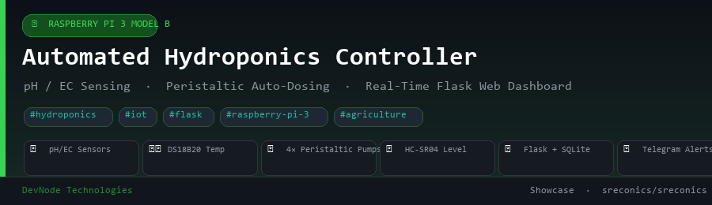
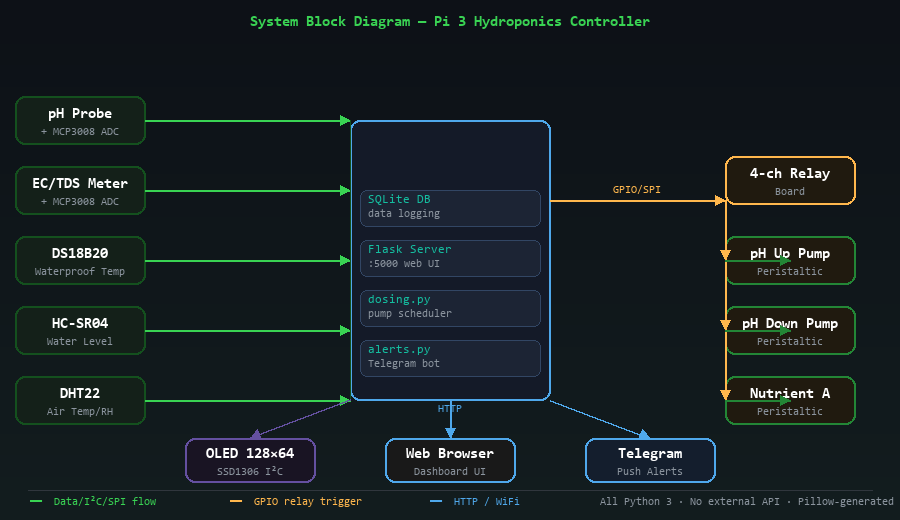

<p align="center">
  
</p>

<p align="center">
  
  
  
  
  
  
</p>

---

## Overview

This project turns a **Raspberry Pi 3 Model B** into a full-featured automated hydroponics controller. It continuously monitors nutrient solution pH, electrical conductivity (EC/TDS), water temperature, and tank level, then autonomously doses pH-adjusting and nutrient solutions via peristaltic pumps whenever readings drift outside target ranges. A local Flask web dashboard provides real-time sparkline charts, and Telegram push alerts notify you of critical events — all running natively on the Pi 3 with no cloud dependency.



## System Block Diagram



## Features

| Feature | Detail |
|---|---|
| pH monitoring + auto-dosing | pH-Up / pH-Down peristaltic pumps, configurable targets (5.8–6.2) |
| EC / TDS monitoring + dosing | Nutrient-A + Nutrient-B pumps fire when EC falls below threshold |
| Water temperature | DS18B20 1-Wire sensor with EC temperature compensation |
| Tank level | HC-SR04 ultrasonic sensor with % full display + low-level alerts |
| Air conditions | DHT22 ambient temperature and humidity |
| Dose safety | Per-pump cooldown (5 min), hourly hard limit (6 doses/hr) |
| Web dashboard | Flask + Chart.js at `:5000`, auto-refreshes every 15 s |
| Data logging | SQLite time-series for readings and dose events |
| Telegram alerts | pH critical, EC low, tank empty, high water temperature |
| Simulation mode | `--simulate` flag — runs the full stack without any hardware |

## Hardware

| Component | Purpose |
|---|---|
| Raspberry Pi 3 Model B | Main controller, runs Python + Flask |
| MCP3008 SPI ADC (×1) | Digitises pH and EC analog signals |
| pH probe + signal board | Solution pH measurement |
| EC/TDS sensor module | Nutrient concentration measurement |
| DS18B20 waterproof probe | Solution temperature (1-Wire) |
| HC-SR04 | Ultrasonic tank level sensing |
| DHT22 | Ambient air temp & humidity |
| 4-channel relay board | Switches 12V peristaltic pump power |
| 4× peristaltic pumps | pH-Up, pH-Down, Nutrient A, Nutrient B |
| SSD1306 OLED (optional) | Local status display |

## Quick Start

```bash
# Clone
git clone https://github.com/sreconics/pi3-hydroponics-controller
cd pi3-hydroponics-controller

# Install dependencies (Pi OS)
pip3 install -r requirements.txt

# Enable hardware interfaces
sudo raspi-config  # SPI, I2C, 1-Wire

# Simulation mode (no hardware needed)
python3 src/main.py --simulate

# Production (real hardware)
python3 src/main.py
```

Open `http://<pi-ip>:5000` in a browser for the live dashboard.

## Install as System Service

```bash
sudo cp systemd/hydroponics.service /etc/systemd/system/
sudo systemctl enable --now hydroponics
sudo journalctl -u hydroponics -f   # live logs
```

## Configuration

Edit `src/config.py`:

```python
TARGET_PH_MIN   = 5.8   # pH lower bound
TARGET_PH_MAX   = 6.2   # pH upper bound
TARGET_EC_MIN   = 1400  # µS/cm lower bound
TARGET_EC_MAX   = 1800  # µS/cm upper bound
DOSE_COOLDOWN_S = 300   # min seconds between consecutive doses
LOG_INTERVAL_S  = 60    # sensor read interval
```

Set Telegram credentials as environment variables:

```bash
export TELEGRAM_TOKEN="your_bot_token"
export TELEGRAM_CHAT_ID="your_chat_id"
```

## Project Structure

```
pi3-hydroponics-controller/
├── src/
│   ├── main.py            # entry point + control loop
│   ├── config.py          # all tunable parameters
│   ├── sensors.py         # pH, EC, DS18B20, HC-SR04, DHT22
│   ├── dosing.py          # relay / peristaltic pump control
│   ├── web_dashboard.py   # Flask API + single-page dashboard
│   ├── data_logger.py     # SQLite read + write helpers
│   ├── alerts.py          # Telegram push notifications
│   └── simulator.py       # synthetic sensor data
├── systemd/
│   └── hydroponics.service
├── docs/
│   ├── wiring.md
│   ├── banner.png
│   └── block_diagram.png
├── requirements.txt
├── LICENSE
└── .gitignore
```

## Wiring

See [`docs/wiring.md`](docs/wiring.md) for full pin-by-pin tables including the HC-SR04 voltage divider, DS18B20 pull-up, and relay board connections.

---

*DevNode Technologies — Daily Showcase · sreconics/sreconics*
